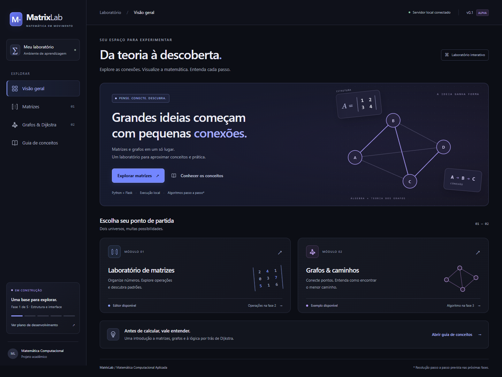
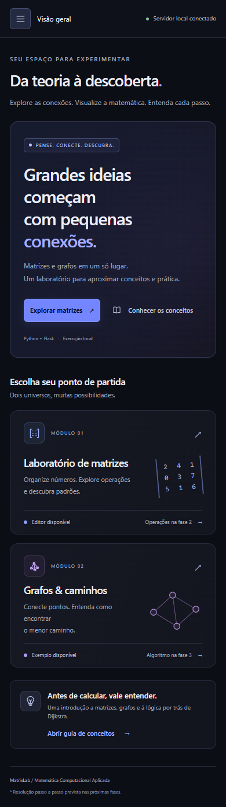

<div align="center">


# MatrixLab

**Da teoria à descoberta.**

Um laboratório interativo de Matemática Computacional Aplicada.<br>
Matrizes, grafos e os caminhos entre conceitos e prática.


[Começar](#executar-localmente) · [Funcionalidades](#o-que-já-funciona) · [Arquitetura](docs/ARCHITECTURE.md) · [Próximas fases](#próximas-fases)

</div>



## Sobre o projeto

O MatrixLab é um projeto acadêmico da disciplina de **Matemática Computacional Aplicada**, desenvolvido para aproximar teoria e experimentação. A proposta é permitir que o estudante edite matrizes, explore grafos ponderados e acompanhe a resolução dos problemas passo a passo.

A aplicação combina **Python e Flask** no backend com **HTML, CSS, JavaScript e SVG** no frontend. Os algoritmos matemáticos serão implementados manualmente em Python, sem NumPy, NetworkX ou bibliotecas que resolvam os cálculos.

> **Primeira versão · v0.1.0-alpha**
>
> Esta entrega corresponde à **Fase 1: fundação, design system e interface funcional**. O editor inicial de matrizes e a visualização do grafo já funcionam. Operações matriciais, Dijkstra, edição sincronizada do grafo e importação/exportação JSON estão planejados para as próximas fases.

## O que já funciona

- **Interface responsiva:** tema escuro, sidebar, menu móvel, estados de foco e navegação por teclado.
- **Editor inicial de matrizes:** crie uma matriz A de 1×1 a 8×8, edite valores, altere dimensões e restaure o exemplo.
- **Rascunho local:** a matriz é salva no navegador e recuperada ao recarregar a página.
- **Grafo de demonstração:** explore quatro nós e cinco arestas em SVG; selecione um nó para consultar suas conexões.
- **Matriz de adjacência:** representação simétrica, somente leitura, gerada a partir dos mesmos dados do grafo.
- **Guia introdutório:** conceitos de matrizes, grafos, condições das operações e funcionamento de Dijkstra.
- **Base Flask:** API JSON, indicador de conexão, tratamento de falhas e página 404.
- **Testes Python:** cobertura da estrutura, dos endpoints e do contrato do exemplo.

Os recursos da aplicação são locais: sem CDN, fontes remotas ou serviços externos obrigatórios durante o uso. Não é necessário instalar Node.js. Os badges acima são apenas elementos do README no GitHub.

<details>
<summary><strong>Ver a interface em dispositivos menores</strong></summary>
<br>

</details>

## Executar localmente

**Pré-requisitos:** Python 3.10 ou superior com `pip`, Git para clonar e um navegador moderno. A instalação inicial das dependências precisa de internet; depois disso, a aplicação funciona localmente.

### 1. Obtenha o projeto

```bash
git clone https://github.com/vicenteedu/A3_matrixLab.git
cd A3_matrixLab
```

Também é possível usar **Code → Download ZIP** no GitHub, extrair o arquivo e abrir um terminal na pasta que contém `run.py`.

### 2. Instale e execute

**Windows / PowerShell**

```powershell
py -m venv .venv
.\.venv\Scripts\python.exe -m pip install -r requirements.txt
.\.venv\Scripts\python.exe run.py
```

Se o Python estiver disponível como `python`, substitua `py` por `python` no primeiro comando. Não é necessário ativar o ambiente virtual nem alterar a política de execução do PowerShell.

**macOS / Linux**

```bash
python3 -m venv .venv
.venv/bin/python -m pip install -r requirements.txt
.venv/bin/python run.py
```

### 3. Abra o laboratório

Acesse **[http://127.0.0.1:5000](http://127.0.0.1:5000)** no navegador. Para encerrar o servidor, pressione `Ctrl+C` no terminal.

<details>
<summary><strong>Solução de problemas de instalação</strong></summary>

- **Python não encontrado:** instale pelo [site oficial](https://www.python.org/downloads/), habilite a opção de adicionar ao PATH e reabra o terminal.
- **`venv` indisponível no Linux:** instale o pacote `venv` correspondente à versão do Python da sua distribuição.
- **Porta 5000 ocupada:** escolha outra porta com o comando abaixo e abra o endereço indicado no terminal.

```powershell
.\.venv\Scripts\python.exe -m flask --app matrixlab run --port 5001
```

No macOS/Linux, substitua o executável por `.venv/bin/python`.

</details>

O servidor inicia sem debug e atende somente no computador local. Esta configuração é destinada ao desenvolvimento e à apresentação acadêmica; publicação em produção exige uma configuração própria.

## Exemplo de demonstração

O grafo inicial é **não direcionado**, com pesos estritamente positivos:

```text
          B
       4 /|\ 8
        / | \
       A  2  D
        \ | /
      10 \|/ 3
          C
```

Para origem **A** e destino **D**, a referência do enunciado é:

```text
Caminho:   A → B → C → D
Distância: 4 + 2 + 3 = 9
```

**Nesta versão, esse resultado é uma referência exibida para a futura validação do algoritmo. Dijkstra ainda não é executado.** As coordenadas dos nós são apenas visuais e não determinam os pesos das arestas.

## Testes e validação

Execute os testes a partir da raiz do repositório:

**Windows / PowerShell**

```powershell
.\.venv\Scripts\python.exe -m unittest discover -s tests -v
```

**macOS / Linux**

```bash
.venv/bin/python -m unittest discover -s tests -v
```

Os **9 testes** verificam página e assets locais, saúde do servidor, contrato JSON, erros 404, pesos e simetria do exemplo, custo da rota de referência, isolamento dos dados e independência entre coordenadas e pesos.

A interface também foi verificada em Chrome com automação de navegador: navegação, persistência, validações do editor, teclado, recuperação de falha da API e cinco larguras de tela. Consulte o [registro de validação](docs/VALIDATION.md) para os cenários e limites dessa verificação.

Os testes de operações matemáticas, Dijkstra e edição sincronizada serão acrescentados junto às respectivas implementações.

## Organização do código

```text
A3_matrixLab/
├── run.py                     # Inicialização do servidor local
├── requirements.txt           # Dependências Python
├── .gitignore
├── .gitattributes
├── README.md
├── matrixlab/
│   ├── __init__.py             # Application factory e rotas de página
│   ├── api/__init__.py         # Endpoints REST
│   ├── domain/
│   │   └── examples.py         # Exemplo canônico, independente de Flask
│   ├── templates/             # Páginas HTML
│   └── static/
│       ├── css/app.css         # Design system e responsividade
│       ├── js/                 # Navegação, editor e visualização SVG
│       └── favicon.svg
├── tests/test_app.py           # Testes da fundação e do exemplo
└── docs/
    ├── ARCHITECTURE.md         # Decisões, contratos e plano técnico
    ├── VALIDATION.md           # Evidências e checklist de validação
    └── images/                # Capturas usadas neste README
```

**Separação de responsabilidades:** Flask cuida do HTTP; o domínio Python concentrará os cálculos; JavaScript apresenta os dados e controla a interação. O histórico de Dijkstra será produzido exclusivamente pelo Python.

### API da primeira versão

- `GET /api/health` — informa aplicação, estado e fase atual.
- `GET /api/graph/example` — retorna nós, posições, matriz de adjacência, origem, destino e referência do enunciado.

No contrato JSON, `null` representa ausência de aresta e `0` é reservado à diagonal. A ordem dos nós define as linhas e colunas da matriz. Não há endpoints de cálculo nesta versão.

## Próximas fases

- [x] **Fase 1 — Fundação:** Flask, layout, design system, editor inicial, grafo de referência e testes da base.
- [ ] **Fase 2 — Matrizes:** adição, subtração, multiplicação, transposta, determinantes 2×2/3×3, identidade, matriz nula e resolução passo a passo em Python.
- [ ] **Fase 3 — Dijkstra:** validação do modelo, algoritmo manual, predecessores, histórico de execução e tratamento de destinos inalcançáveis.
- [ ] **Fase 4 — Editor de grafos:** criação e remoção de nós/arestas, arraste, edição de pesos, sincronização bidirecional e importação/exportação JSON.
- [ ] **Fase 5 — Aprendizagem e refinamento:** reprodução das etapas, propriedades com exemplos verificados, conteúdo educativo ampliado e testes integrados.

Veja o [plano de arquitetura](docs/ARCHITECTURE.md) para os critérios de aceitação de cada fase.

## Observações da versão alpha

- O rascunho pertence ao navegador e à origem usados; não há sincronização entre computadores.
- Reduzir uma matriz descarta as células fora das novas dimensões.
- O grafo e sua matriz de adjacência são somente leitura nesta entrega.
- O indicador de servidor é atualizado ao abrir a aplicação e ao tentar novamente um carregamento; não é monitoramento contínuo.

## Referências

- [Flask — Application factories](https://flask.palletsprojects.com/en/stable/patterns/appfactories/)
- [Flask — Testes de aplicações](https://flask.palletsprojects.com/en/stable/testing/)
- [Flask — Instalação](https://flask.palletsprojects.com/en/stable/installation/)

---

<div align="center">
Projeto acadêmico de Matemática Computacional Aplicada · <a href="https://github.com/vicenteedu">vicenteedu</a><br>
<sub>MatrixLab · Pense. Conecte. Descubra.</sub>
</div>
